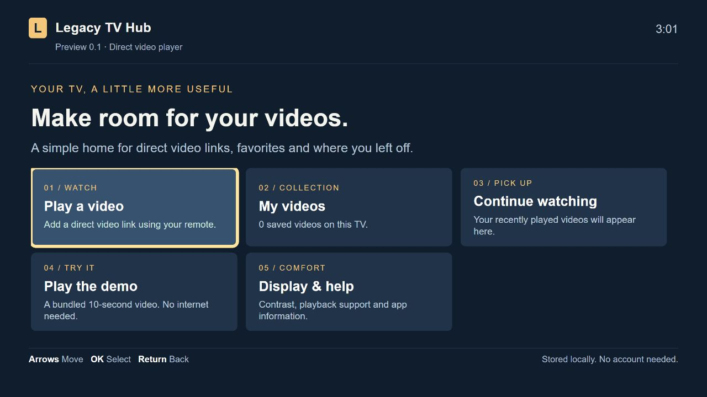

# Legacy TV Hub

[](https://github.com/Coding-Dev-Tools/legacy-tv-hub/actions/workflows/checks.yml)

A remote-controlled media hub and temporary setup tools for older Samsung TVs. Save compatible direct video links, keep watch positions, and store the app and its bundled demo in a compatible TV browser. It is a browser app, not a replacement operating system or streaming-service app.

**Preview 0.3.2.** The hardware previously tested is Samsung 2014 Legacy / Orsay (UN55HU7250); this UI revision still needs a physical-TV check. It refreshes the remote-friendly browser interface and makes its software-only limits explicit. It does not replace Smart Hub, update firmware or provide Paramount+ or other protected streaming services. See the [feature matrix](docs/compatibility.md) and [measured results](docs/verification.md).

**Latest native installation attempt (October 22, 2026): not installed.** The TV was reachable and the native widget built, but its Samsung API reported Developer Mode off; a 120-second app-sync server run received no manifest or package request. No firmware, OS or TV app was changed. See the [measured install attempt](docs/verification.md#october-22-0526-utc-native-install-attempt).

[Browser preview](https://coding-dev-tools.github.io/legacy-tv-hub/app/) · [GitHub release packages](https://github.com/Coding-Dev-Tools/legacy-tv-hub/releases) · [Installation details](docs/standalone-browser.md)



## Set up the offline browser copy

Use Python 3.10+ on a computer connected to the same LAN as the powered-on TV. From a downloaded or cloned copy of this repository:

```sh
python serve.py --setup --tv YOUR_TV_IP
```

On the tested UN55HU7250 this command:

1. Builds and verifies the offline app, then starts a temporary server on the selected LAN interface (port 8769 by default).
2. Identifies the TV and requests its browser to open the local app.
3. Waits for the TV to acknowledge that the copy is stored. The acknowledgment contains only the app version and a temporary setup token.
4. Closes the server and requests the same app URL again from the TV's cache.

Bookmark the exact URL printed by the command in the TV browser. Once the copy is stored, the app and bundled demo can run without a computer serving their files. An existing computer is needed again only for a future transfer or update. Saved video links still need their own available media source. Browser-cache eviction, clearing TV data or a changed origin may require another transfer. **Persistence across TV power loss remains unverified.** A launch response alone does not prove page execution; the command reports a timeout as an unconfirmed setup.

`--port 8770` selects another browser-serving port; `--duration 300` changes the maximum wait (default 900 seconds, maximum 3600). The server stops early after cache acknowledgment. It changes no firewall rules. If automatic launch is unavailable, use the [manual browser instructions](docs/standalone-browser.md). Other models require their own tests and an explicit `--expected-model`; this is not general Samsung device discovery.

Modern browsers have removed AppCache. Use the regular [browser app](https://coding-dev-tools.github.io/legacy-tv-hub/app/) for a desktop preview; older TVs may also fail to connect to modern HTTPS hosts. Temporary HTTP transfer avoids that hosting requirement on the measured TV.

## Features and support

| Capability | Status |
| --- | --- |
| Direct video links, favorites, resume and recent videos | Implemented; limited by the TV's existing decoder and network support |
| Remote-style arrows, OK/Enter, Back/Return and playback controls | Implemented; desktop key tests pass; physical hardware-key behavior still needs a model-specific report |
| On-screen link keyboard, high contrast and local storage | Implemented; no account or external runtime packages |
| Cached app and bundled H.264/AAC demo | Preview 0.3.1 document reopen and complete playback verified with asset serving stopped. Preview 0.3.2 needs its own TV check; power-cycle persistence remains unverified. See [evidence](docs/verification.md) |
| Samsung native user widget | Packaged preview; installation/removal and optional native PLAYER remain unverified |
| Newer official Samsung firmware | Use Samsung's exact-model updater; this repository has no firmware image |
| New Samsung Smart Hub/Tizen on the HU7250 family | Samsung SEK-4500/ZA external Evolution Kit documented; availability of a complete working unit and Paramount+ are unverified. It does not replace the TV's internal firmware. See the [installation and OS research](docs/os-replacement.md#official-external-tizen-platform-upgrade-sek-4500za) |
| Paramount+ and other unsupported subscription services | No integration or verified protected playback |
| Tizen, webOS, Android TV and Roku native packages | Not implemented; each needs its own adapter and supported installation route |

A service's watch-page URL is not a direct media link. Root access, a new home screen or a codec alone does not provide an authorized subscription player or its protected playback components.

For owners of the HU7250 family who want Samsung's newer TV interface, the researched hardware path is the external **SEK-4500/ZA Evolution Kit**. Samsung documents Tizen and HU7200-series compatibility; this does not install an OS on the TV's main board. Paramount+ on this kit is unverified, and it is a 2018-era platform rather than a current 2026 TV OS. See the [model-specific OS investigation](docs/os-replacement.md#official-external-tizen-platform-upgrade-sek-4500za) before considering a used unit.

## Native Samsung 2014 package

```sh
python build.py
python serve.py --tv YOUR_TV_IP
```

The build creates native widget **0.302**, portable web **0.3.2**, and offline web **0.3.2** archives. `release.json` and `SHA256SUMS` record their sizes and checksums. The native sync server uses port 80. Installation still requires Samsung's on-TV developer/sync workflow; see [installation and removal](docs/samsung-legacy.md). This package does not flash the TV and does not add streaming services.

## Develop and verify

Node is needed only for development tests. TV setup uses the Python standard library.

```sh
npm ci --ignore-scripts
npm test
python build.py
python -m unittest discover -s tests -v
npx playwright install chrome
npm run test:browser
```

Browser tests use a separate headless profile and exercise complete H.264/AAC playback, pause/resume, remote-style navigation, delayed metadata, editing, storage recovery and video errors. On Windows with Edge installed, set `HUB_BROWSER_CHANNEL=msedge`; `HUB_PYTHON` can select the Python executable. Linux CI uses Chrome. Chromium-browser results are distinct from measurements on a physical Samsung TV.

[GitHub Actions](.github/workflows/checks.yml) runs the core/ES5 and Python checks on Linux and Windows, checks generated release metadata, and runs browser playback checks on Linux. All runtime application scripts must parse as ES5. ZIP entries use fixed dates, Unix attributes and normalized text; repeat-build checks cover all three packages.

See [CONTRIBUTING](CONTRIBUTING.md), [security reporting](SECURITY.md), the [0.3.2 release notes](docs/release-0.3.2.md), and [OS-replacement research](docs/os-replacement.md). Compatibility reports should include actual installation, remote input, complete playback and restart results, with serial numbers, network names, accounts and pairing data omitted. MIT licensed; see [LICENSE](LICENSE).
