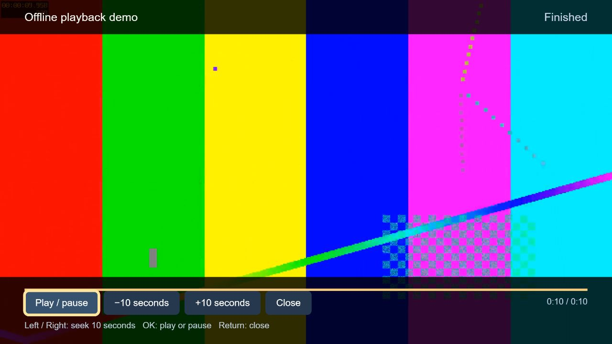
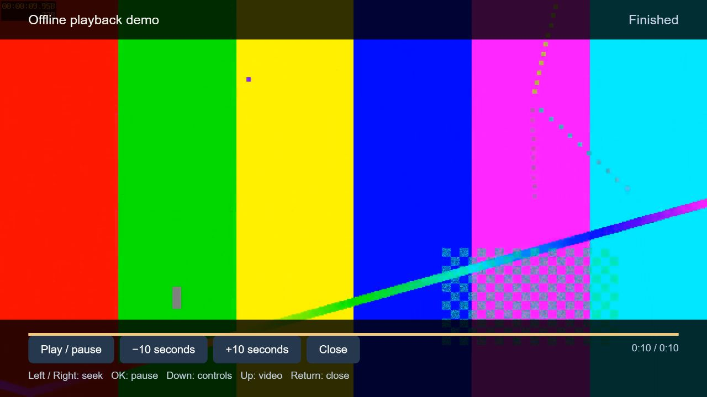

# Verification record

## October 22: preview 0.3.2 browser-interface refresh

Preview 0.3.2 passed the repository's desktop checks: five Playwright browser tests in Chromium, all Node core/native/offline/ES5 checks, all 25 Python tests, and a complete package build. These checks cover the refreshed browser UI and bundled demo in desktop Chromium. They do not establish operation on the Samsung browser.

The TV could not be reached at its last reported address during this run. Its known browser-control ports did not answer, and the local network table did not provide a usable device address for a targeted wake. No package or browser command was sent to the TV, and no firmware was changed. Therefore this preview's visual appearance, remote operation, cached reopen, library persistence and bundled-demo playback have **not** been verified on the TV. The earlier 0.3.1 physical cached-reopen and demo result remains valid only for that version. A cold boot and cache persistence across power loss remain **unverified**. The sanitized run record is [here](evidence/ui-refresh-2026-10-22.json).

Paramount+ login/playback and other protected streaming were not attempted: this browser app adds no service client, current DRM or TV operating-system support.

## October 22, 05:13 UTC: read-only network reconnection

The TV now responds on its LAN identity service. A read-only request returned HTTP 200 and identified `UN55HU7250`; the advertised MainTVAgent2 and MultiScreenService descriptions also responded. These descriptions do not expose the installed firmware version, and the MainTVAgent2 action list contains no firmware-version or firmware-update action. The built-in updater's on-screen result therefore remains unknown. No remote-control, app-installation or firmware-update command was sent, and no TV software changed. This confirms network reachability only; it does not establish that an OS update can be deployed over Wi-Fi. See the [sanitized measurement](evidence/reconnected-tv-2026-10-22.json).

## October 22, 05:26 UTC: native install attempt

The TV's identity API responded and identified `UN55HU7250` / `14_NT14U_2D_BT`. It reported `developerMode: 0`, `developerIP: 0.0.0.0`, and firmware `Unknown`; the owner's reported 1330 is still not confirmed by the TV API. A 120-second port-80 Samsung user-app sync server served no TV manifest or widget-package requests. The built-in remote-control WebSocket opened, but this connection returned `isHost: false`, and the `ms.remote.control` command was rejected as unrecognized; no remote key was accepted through that attempt. No package install or firmware operation occurred. The native widget ZIP built successfully and all repository checks passed, but **the widget is not installed**. This attempt demonstrates that building and serving the package do not bypass the on-TV Developer Mode/App Sync step. See the [sanitized record](evidence/native-install-attempt-2026-10-22.json).

A later SOAP `SendKeyCode` request to the advertised MultiScreenService timed out, so whether the TV acted on it is unconfirmed. Afterward, the identity, multiscreen and browser services all stopped responding; a network wake check did not restore a response. The cause of the lost reachability is unknown. No further control requests were sent.

## October 21, 23:39 New York: network reconnection

A wake-on-LAN packet addressed to the TV's single known network neighbor was followed by successful identity and service checks. Samsung's API identified the target as UN55HU7250 / 2014 NT14U, US region, wireless. Its firmware field returned `Unknown`; the owner-reported 1330 could not be confirmed remotely. Three UPnP descriptions and the known control-service TCP ports then responded. No browser launch, firmware update, cold boot, or Paramount+ playback was attempted during this check. The [sanitized record](evidence/reconnected-tv-2026-10-21.json) distinguishes restored network access from software-upgrade results.

Samsung's [exact-model support page](https://www.samsung.com/latin/support/model/UN55HU7250FXZA/) listed 1320.0, below the owner's reported 1330; it was not installed. Samsung's Legacy FAQ says Tizen applications are incompatible with Legacy-platform TVs, while [Paramount+ lists Samsung Tizen models from 2017 onward](https://support.paramountplus.com/s/article/PI-On-which-devices-can-I-watch-Paramount?language=en_US). This connection check therefore does not change the blocked status for a modern OS or Paramount+ playback.

## October 21: restart verification attempt

The identified TV's last address did not answer SSDP discovery or its identity API at 09:10 UTC. Subsequent direct checks of its three known control ports also timed out. The app asset listener remained closed. A temporary report-only listener could not serve app files and received no TV execution reports during these checks. No remote power command or firmware change was sent. The TV's power state and current address cannot be inferred from timeouts.

Consequently, a TV cold boot and post-restart playback/storage could not be observed. Restart persistence remains **unverified**; the previous successful cached document reopen is a separate result. See the [sanitized attempt record](evidence/restart-attempt-2026-10-21.json) and [physical restart test procedure](restart-test.md). Paramount+ login and protected playback remain unimplemented and unverified.

## October 21: patch 0.3.1

The first hosted run passed on Windows but the Linux checksum gate caught a native/portable ZIP ordering difference: Windows filesystem path comparison sorted uppercase names differently. The build now explicitly sorts case-sensitive archive names, with a regression assertion covering all three archives. The checksum gate stays enabled; original 0.3.0 release assets are unchanged.

The physical UN55HU7250 acknowledged the 0.3.1 production cache. A repeat of the separate online/offline observer test also passed for this exact app version: different document, closed asset listener, new app boot, full 10.023-second video, held pause, resumed playback, temporary storage check and return Home. No asset requests were served after listener closure. See [the 0.3.1 measurement and asset hashes](evidence/physical-browser-0.3.1.json). The limits described in the 0.3.0 record continue to apply. The final clean cached document request is distinct from the instrumented execution test.

## October 21: preview 0.3.0

Local checks passed: four Node suites (core, native bridge contract, offline setup acknowledgment, ES5 parsing), 25 Python tests, and four real Edge/Chromium browser scenarios. The browser suite completed the bundled H.264/AAC video, held pause, resumed to the end, and checked navigation, early close before metadata, source edits, damaged storage and playback error recovery. A clean npm install and audit passed with zero reported vulnerabilities. These are development checks, not Samsung hardware certification.

The new `--setup` command ran against the physical UN55HU7250. Its browser acknowledged a stored 0.3.0 copy. The setup server stopped automatically and requested a cached reopen. A separate instrumented test then measured complete playback both online and after a different document had loaded and the asset listener was closed. The offline boot was new; its clock progressed through all 10.023 seconds, pause held, resume completed, a temporary local-storage check passed, and the app returned Home. The report-only listener supplied no assets and received zero asset requests after closure. Both temporary listeners were then stopped.

The measurement used the production app code with one observer script reference and an observer manifest entry. The [sanitized record and deployed asset hashes](evidence/physical-browser-0.3.0.json) identify that scope. The clean cached `index.html` was requested after the diagnostic listeners stopped; that final clean-document execution has no separate observer result. No remote media links or personal library contents were collected.

TV power-cycle persistence, native installation/removal, native PLAYER playback, physical hardware-key input, human confirmation of picture/audio and Paramount+ protected playback remain unverified. No firmware was written. GitHub-hosted CI results are recorded by the Checks workflow, separately from these local measurements.

Date: October 20, 2026. Records for previews 0.1 and 0.2.

## Physical TV

Samsung UN55HU7250, 2014 NT14U family, configured for US, connected by Wi-Fi:

- Identity and advertised service descriptions read over the local network.
- Normal encrypted remote PIN pairing completed with acknowledgement validation; a Menu button command was sent. No physical-screen confirmation of that button's effect was received.
- A generated H.264/AAC MP4 was fetched by the TV's media renderer.
- The renderer reported PLAYING at 2, 6 and 10 seconds, then STOPPED at the full 10-second duration with status OK.
- The original HDMI1 input was restored and the temporary media server stopped.
- These are API-level playback observations. A person has not confirmed picture/audio, and this is not a native-widget HTML playback test.

## Shared app: desktop browser

Chromium browser preview:

- Right arrow moved between home cards; OK opened the selected screen.
- On-screen character input and Backspace changed the video link.
- An invalid link produced visible validation feedback.
- A named video was saved and remained in the library after page reload.
- The bundled demo reached `ended=true`, currentTime=10, duration=10, with no video error.
- High contrast persisted after reload; removal of a test library item completed through the confirmation screen.

## Automated checks run locally

- Library persistence, duplicate URL handling, resume boundaries, rejected unsafe URL schemes/userinfo, corrupt storage and unavailable storage.
- ECMAScript 5 grammar for shared scripts and the first platform adapter.
- Native manifest, ZIP integrity and deterministic package build.
- HTTP byte ranges including suffix requests, HEAD, sync XML and rejection of source/traversal requests.

## Public distribution

The public GitHub Pages app was opened in Chromium and its complete demo reached ended=true at 10 seconds without a video error. Both public release ZIPs were downloaded anonymously and matched the published sizes and SHA-256 digests.

## October 20 retest of the published release

The production package and its unchanged demo were tested again on October 20, 2026. The overall request for a replacement that runs all modern streaming services **has not been met**.

| Check | Result | Evidence and limit |
| --- | --- | --- |
| Fresh dependency installation and JavaScript checks | PASS | `npm ci --ignore-scripts --no-audit --no-fund`; `npm test`. State/resume/error cases and ES5 syntax passed. |
| Native and portable package rebuild | PASS | Both rebuilt SHA-256 digests exactly matched `release.json` and the published release. |
| Local HTTP/package tests | PASS | All three Python test methods passed, including byte ranges, HEAD, sync manifest and file isolation. |
| Public browser demo | PASS in desktop Chromium | Arrow/OK navigation started the demo. It reached `currentTime=10`, `duration=10`, `ended=true`, `error=null`. Escape returned home. This is not a test of the old TV browser. |
| TV media-renderer playback | PASS at the network API level | The generated MP4 was byte-identical to `media/demo.mp4` in the published native ZIP. The TV fetched it, reported PLAYING with a progressing clock, then STOPPED at 10/10 seconds with status OK. HDMI1 was restored and the temporary media server stopped. Picture and sound were not confirmed by a person. |
| Remote browser launch | UNSUPPORTED by this TV API | A correctly serialized `RunBrowser` request returned HTTP 200 with `NOTOK_NotSupport`. Network access alone did not open the browser. |
| Native app execution | NOT VERIFIED | No reachable SDB installer was found; the known app's DIAL routes returned 404. Those checks do not prove every installation method is impossible. The documented on-TV developer sync/launch step remains necessary to attempt native testing. |
| Paramount+ or another subscription service | NOT IMPLEMENTED / NOT TESTED | No service integration, account login, license acquisition or protected playback test exists in this release. |
| All modern streaming services and software | NOT MET | The shared interface and one unprotected clip establish neither new browser/OS capabilities nor authorized service playback. |

An instrumented, removable test widget was prepared privately using the same production scripts, styles, adapter and video. It can report its own startup, key codes, a temporary storage round-trip and video state after installation. Preparing or serving that package is not evidence it ran on the TV. Private device addresses, pairing authentication and test collector tokens are excluded from this repository.

The [machine-readable summary](test-results-2026-10-20.json) records the measured checks and their scope.

## Preview 0.2 native player development

The new native bridge and read-only firmware information are implemented, but native installation/execution still have no successful TV result. The target became reachable and identified correctly again; after the reported blank screen, an Exit command was sent and network queries reported HDMI1 with no renderer media present and status OK. The temporary test installer subsequently stopped with **zero manifest fetches, zero package fetches and zero startup results from the TV**. A later identity request timed out. None of this proves installation, a firmware update or a repaired display.

| Check | Result | Scope |
| --- | --- | --- |
| JavaScript state, native bridge and ES5 checks | PASS | Native API contracts use a mock plugin, including synchronous failures and callbacks after pause/close. No hardware API execution is implied. |
| Python tests | PASS, 12 methods | Nine read-only firmware-inspection cases and three package/server cases. |
| Reproducible native/portable packages | PASS | Source line endings are normalized; package contents and hashes are recorded in `release.json`. |
| Real bundled video in current browser app | PASS in desktop Chromium | Immediate pause stayed Paused, playback resumed and reached 10/10 seconds with `ended=true`, `error=null`; Return/Escape restored home. |
| Remote access to native-player and fallback buttons | PASS in labeled desktop simulation | Down focused controls, Left/Right selected the player button and OK switched. Pause held its position, paused seeking retained Paused, replay reached completion, and Browser player switched back. |
| Absent native API | PASS in labeled desktop simulation | A visible error and opaque background remained usable; remote keys selected Browser player and the real HTML demo completed. |
| Native Samsung PLAYER, NNavi firmware query, install/restart/removal | NOT VERIFIED | The TV has not downloaded or started the instrumented app. |
| New OS/browser or authorized subscription playback | NOT IMPLEMENTED / NOT TESTED | No modern service is claimed to work. |

The [0.2 machine-readable record](test-results-0.2.0.json) separates the desktop simulation from the real browser clip and prior physical-TV DLNA evidence. See the [new component's design and hardware acceptance](native-player.md).

## October 20 evening: physical browser execution

The owner confirmed **Legacy TV Hub was visible in the TV browser**. This is the first verified execution of the shared app on this physical TV, distinct from desktop simulations, native widgets and the earlier DLNA test.

- The TV positively identified as UN55HU7250 / `14_NT14U_2D_BT` after initial timeouts.
- Its MultiScreenService description advertised a DIAL control base ending in `/ws/app/`. A POST to its WebBrowser resource with a **plain application URL** and a bare Host header caused the TV to fetch and execute the page. The DIAL state remained stopped even while JavaScript and video ran; it is only an advisory on this unit.
- The shared 0.2 app and bundled MP4 were served by a temporary local test server. Instrumentation reported a complete 10.023-second clip, `ended=true`, no video error, successful pause/resume, return home and a storage round-trip. Test actions used the app's own buttons; no physical remote key event was captured. A person has not confirmed the video's picture and audible sound.
- The measured user agent was Chromium 25.0.1349.2 / WebKit 537.42 on ARMv7. MediaSource was not exposed. The modern encrypted-media API was not exposed on the HTTP test page; this alone does not prove absence of DRM in every context. Legacy encrypted-media entry points were present in the initial capability page.
- Neither NaCl MIME types nor native Samsung PLAYER/NNavi method entry points were exposed in this **browser** context. This does not measure the installed-widget context.
- A Samsung-hosted HTTPS PNG loaded and the TV clock was within about one second of server UTC. The project's GitHub Pages PNG failed, despite an independent PC fetch returning HTTP 200. The cause was not established, and this is not evidence that all HTTPS fails.
- The source portal was accessible in a real browser; exact model and NT14U searches both returned zero results. This does not establish that source was never published.

The new [browser launch tool](samsung-legacy-browser.md) reproduces the measured request after verifying the model and advertised endpoint. All 18 Python test methods passed, including six new launcher cases. It was then exercised against the physical TV and a fresh page startup was recorded. The native/portable 0.2 archives and app source were unchanged by this tool addition.

See the [sanitized physical record](evidence/physical-browser-2026-10-20.json). The test's private observer collected its own playback/storage/capability results only; it is not included in the distributed app. **A working local browser copy does not meet independent installation, replacement-OS or Paramount+ acceptance.** The temporary native installer remains a separate test, with no verified installation yet.

## October 21: cached browser copy

Two physical-TV trials stored the app and bundled clip with HTML5 AppCache. In each trial a different document executed, the app asset listener was closed, and a fresh app document reopened from cache. The full 10.023-second H.264/AAC clip reached `ended=true` without a video error. The preview 0.2.1 adapter trial also returned home and displayed its offline-copy status. A separate private result listener served no app assets.

The production offline builder creates a relative-path manifest and a reproducible ZIP. The temporary server checks all declared asset hashes and supplies the required manifest MIME type. All **23 Python test methods** passed, including reproducibility, modified-asset rejection, path isolation, manifest reachability and ranged video. JavaScript state/native-contract checks and ES5 parsing also passed. The native tests remain mocks, not hardware validation.

After the measured offline trial, the actual public offline server briefly supplied the clean build. The TV reported `updateready` and **Update saved. Reopen to use it.**; the cache was swapped to that build. The public app contains no diagnostic observer or result listener. See the [sanitized evidence](evidence/physical-cache-2026-10-21.json), [archive hashes](evidence/offline-web-0.2.1.json) and [reproduction steps](standalone-browser.md).

This establishes a document reopen without continuous asset serving. Browser-process restart and TV power-cycle persistence remain unverified: the browser's advertised stop endpoint returned HTTP 404. No physical remote key event was captured, and picture/audible sound still lack human confirmation. The normal native sync server had recorded no widget downloads or startup results. No firmware, browser engine, new decoder or protected-service integration was installed. **Paramount+ and the overall modern-TV replacement requirement remain unmet.**

## Unverified

Native user-widget installation/player, actual physical TV-app key delivery, audible sound, app library/resume persistence across a TV restart, native removal, cached delivery across a browser/TV restart, other TV browsers/manufacturers and subscription streaming. A warm cached document reopen without its asset server has passed. No firmware was installed. No Paramount+ login or playback has been demonstrated.
